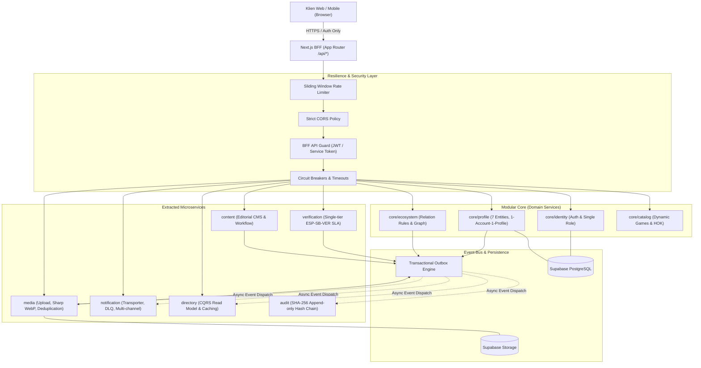

# Arsitektur Sistem ESPORT SUMBAR V3

**Status**: Produksi / Final V3  
**Tanggal**: November 2026  
**Pola**: Monolit Modular & Layanan Mikro Hibrida (*Pragmatic Hybrid Option B*)  
**Monorepo Engine**: Turborepo + Next.js 16 (App Router) + Supabase

---

## 1. Ikhtisar Arsitektur

ESPORT SUMBAR V3 dibangun dengan filosofi rekayasa perangkat lunak modern tingkat enterprise yang mengeliminasi ketergantungan birokrasi lawas dan menetapkan platform sebagai **pemilik, operator, dan pemverifikasi tunggal** ekosistem esport Sumatera Barat.

Sistem dirancang menggunakan **Pola Strangler Fig** yang memecah domain besar menjadi modul-modul kohesif tinggi dan layanan mikro independen tanpa *tight coupling* basis data:

---

## 2. Peta Domain & Batas Impor (Bounded Contexts)

### A. Subdomain Core
1. **`core/identity`**:
   - Tanggung jawab: Mengelola akun pengguna, sesi otentikasi, dan hak akses tunggal (`platform_admin` vs `user`).
   - Batas: Terisolasi dari tabel profil; tidak melakukan JOIN ke data profil.
2. **`core/profile`**:
   - Tanggung jawab: Mengelola 7 entitas profil (*Player, Coach, Team, Community, Venue, School, Campus*).
   - Penegakan: **1 Akun = 1 Profil** (`UNIQUE(account_id)`). Jenis entitas bersifat permanen (*immutable*).
   - Privasi UU PDP: Menyaring secara otomatis data sensitif (NIK, KK, KTP).
3. **`core/ecosystem`**:
   - Tanggung jawab: Menegakkan aturan bilateral `relation_rules` (maksimal relasi aktif per jenis entitas, keselarasan game, dan kaskade pemutusan saat profil dinonaktifkan).
4. **`core/catalog`**:
   - Tanggung jawab: Mengelola cabang game resmi dinamis termasuk Honor of Kings (HOK), roles, dan tier ranks.

### B. Layanan Terekstraksi (Extracted Services)
1. **`verification` + `audit`**:
   - Tanggung jawab: Mesin status verifikasi satu pintu (`unverified` → `submitted` → `under_review` → `verified`/`rejected`).
   - Penomoran resmi tunggal: `ESP-SB-VER-YYYY-XXXX`.
   - Pemisahan tugas (*separation of duties*): Admin dilarang memverifikasi profilnya sendiri.
   - Jejak audit append-only SHA-256 (`calculateAuditLogHash` & `verifyAuditTrailIntegrity`).
2. **`directory`**:
   - Tanggung jawab: Pola CQRS Read Model terproyeksi dari peristiwa Outbox dengan pencarian cepat, filter multi-dimensi, dan paginasi sub-50ms.
3. **`media`**:
   - Tanggung jawab: Validasi magic bytes gambar, kompresi Sharp WebP, tanda tangan unggah sementara, kuota penyimpanan per entitas, dan pembersihan berkas yatim.
4. **`notification`**:
   - Tanggung jawab: Pengiriman email transaksional dan in-app, preferensi opt-in pengguna, retry-jitter, dan penanganan Dead-Letter Queue (DLQ).
5. **`content`**:
   - Tanggung jawab: Alur kerja editorial berita (*Draft*, *Editorial Review*, *Published*, *Archived*) dengan tag-based cache revalidation.

---

## 3. Katalog Peristiwa Asinkron (Domain Event Catalog)

Seluruh integrasi antar-domain berjalan secara asinkron menggunakan pola **Transactional Outbox Engine** (`outbox_events`):

| Nama Peristiwa | Schema Payload | Produser | Konsumen Utama |
|---|---|---|---|
| `ProfileCreated` | `ProfileCreatedEventSchema` | `core/profile` | `directory`, `notification` |
| `ProfileUpdated` | `ProfileUpdatedEventSchema` | `core/profile` | `directory`, `verification` (jika data kunci berubah) |
| `ProfileSuspended` | `ProfileSuspendedEventSchema` | `core/profile` | `directory`, `core/ecosystem`, `notification` |
| `ProfileDeleted` | `ProfileDeletedEventSchema` | `core/profile` | `directory`, `media`, `core/ecosystem` |
| `VerificationSubmitted` | `VerificationSubmittedEventSchema` | `verification` | `notification`, `audit` |
| `VerificationDecided` | `VerificationDecidedEventSchema` | `verification` | `core/profile`, `directory`, `notification`, `audit` |
| `RelationRequested` | `RelationRequestedEventSchema` | `core/ecosystem` | `notification`, `audit` |
| `RelationApproved` | `RelationApprovedEventSchema` | `core/ecosystem` | `directory`, `notification`, `audit` |
| `RelationEnded` | `RelationEndedEventSchema` | `core/ecosystem` | `directory`, `notification`, `audit` |
| `MediaUploaded` | `MediaUploadedEventSchema` | `media` | `audit` |
| `MediaReplaced` | `MediaReplacedEventSchema` | `media` | `media` (pembersihan berkas lama) |
| `ArticlePublished` | `ArticlePublishedEventSchema` | `content` | `notification`, `content/cache` |

---

## 4. Mesin Ketahanan & Keamanan (Resilience & Security)

### A. Kebijakan Ketahanan (@esport-sumbar/lib/resilience)
- **Timeout**: Membatasi panggilan layanan downstream maksimal 3000ms–5000ms.
- **Retry dengan Full Jitter**: Algoritma eksponensial $T_{delay} = \min(M, B \times 2^{attempt-1}) \times \text{random}(0, 1)$ untuk meredam *thundering herd*.
- **Circuit Breaker**: Status `CLOSED` → `OPEN` setelah 4–5 kegagalan berturut-turut, jeda pemulihan 15 detik sebelum fase percobaan `HALF_OPEN`.
- **Degradasi Anggun (Graceful Degradation)**: Jika penyedia eksternal gagal, transaksi lokal tetap diproses dan dialihkan ke fallback atau antrean outbox.

### B. Proteksi Keamanan BFF
- **Zero Direct DB Access dari Klien**: Komponen browser (`"use client"`) dilarang melakukan kueri basis data langsung (`.from`). Supabase JS di browser hanya untuk sesi Auth.
- **Service Tokens Berumur Pendek**: Token internal HMAC-SHA256 (TTL 5 menit) untuk panggilan antar-layanan aman.
- **Kebijakan CORS Ketat**: Menolak wildcard `*` pada rute berkredensial.
- **Rate Limiting Berlapis**: Sliding window berbasis IP & User ID (Publik 120 req/m, Autentikasi 60 req/m, Admin 120 req/m, Sensitif 15 req/m).

---

## 5. Indeks Keputusan Arsitektur (ADR Index)

1. **[ADR-001: Penghapusan Total Ketergantungan Struktur Birokrasi Lawas](file:///d:/AI%20AGENT/ESPORT%20SUMBAR%20V2/docs/adr/ADR-001-eliminasi-dependensi-esi.md)**
2. **[ADR-002: Standar Registrasi Verifikasi Tunggal ESPORT SUMBAR](file:///d:/AI%20AGENT/ESPORT%20SUMBAR%20V2/docs/adr/ADR-002-penomoran-verifikasi-tunggal.md)**
3. **[ADR-003: Konsolidasi Peran Pengguna Tunggal & Penghapusan Multi-Admin Wilayah](file:///d:/AI%20AGENT/ESPORT%20SUMBAR%20V2/docs/adr/ADR-003-peran-pengguna-tunggal.md)**
4. **[ADR-004: Pola Pengambilan Keputusan Arsitektur Transisi Layanan Mikro Hibrida](file:///d:/AI%20AGENT/ESPORT%20SUMBAR%20V2/docs/adr/ADR-004-transisi-microservices-strangler.md)**
5. **[ADR-005: Modularisasi Core & Eliminasi SQL JOIN Lintas Domain](file:///d:/AI%20AGENT/ESPORT%20SUMBAR%20V2/docs/adr/ADR-005-modular-core-and-database-separation.md)**
6. **[ADR-006: Peta Jalan Arsitektur Layanan Mikro Hibrida (Option B)](file:///d:/AI%20AGENT/ESPORT%20SUMBAR%20V2/docs/adr/ADR-006-microservices-hybrid-architecture.md)**
