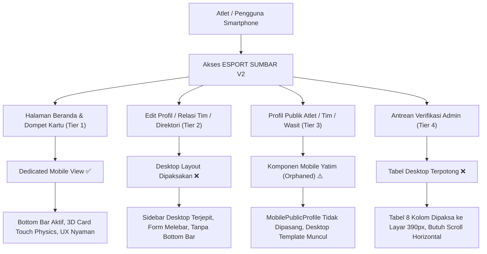
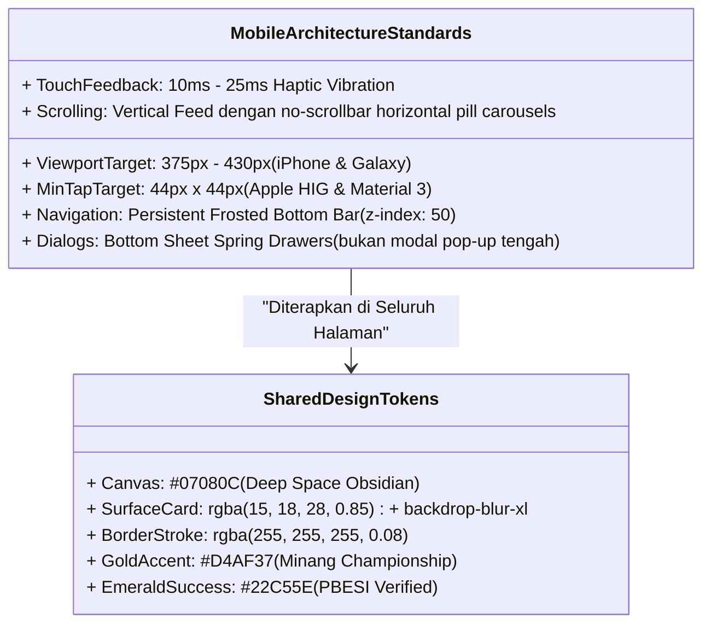

# 📱 AUDIT KOMPREHENSIF UI/UX MOBILE: ELIMINASI "DESKTOP YANG DIPAKSAKAN KE MOBILE"
**Dokumen Resmi Evaluasi Desain Produk Digital & Arsitektur Pengalaman Pengguna (UX)**  
*Oleh: Senior Lead UI/UX Designer*  
*Tanggal: 6 November 2026 | Dokumen ID: UX-AUDIT-MOB-02 | Status: PRIORITY REMEDIATION PLAN*

---

## 🧭 Executive Summary: Ilusi Optimasi Mobile (Responsive vs Mobile-First)

Salah satu kelemahan terbesar yang sering terjadi pada platform web modern adalah **"Ilusi Optimasi Mobile"**: pengembang merasa sebuah halaman sudah *mobile-friendly* hanya karena elemen-elemennya mengecil dan tidak meluber keluar layar (*responsive CSS breakpoint*).

Dari kacamata **Senior Lead UI/UX Designer**, **merampingkan layout desktop ke ukuran 390px BUKANLAH desain mobile**. 
- Desktop didesain untuk **mouse kursor (presisi 1px)** dan bidang pandang lanskap lebar (*horizontal visual scanning*).
- Mobile didesain untuk **ibu jari manusia (*Thumb Zone ergonomics*)**, orientasi vertikal, navigasi satu tangan, dan interaksi berbasis *gesture* (swipe, pull-to-refresh, bottom sheet).

Di dalam **ESPORT SUMBAR V2**, saat ini terjadi **dikotomi pengalaman pengguna yang tajam**:
1. Beberapa halaman inti (Beranda, Dompet Kartu, Verifikasi Pribadi, Explore) telah memiliki arsitektur komponen khusus mobile (`MobileHome`, `MobileCardWallet`, `MobileVerificationTracker`).
2. Namun, **lebih dari 70% halaman lainnya masih memaksakan tampilan desktop ke layar HP**. Pengguna menemukan *sidebar desktop* terjepit di HP, tabel statistik lebar yang terpotong, dropdown `<select>` jadul yang sulit ditekan, ketiadaan bilah navigasi bawah (*bottom bar*), dan ketiadaan interaksi kartu 3D di halaman profil publik atlet.



---

## 📊 Matriks Audit Seluruh Rute Aplikasi (The Route UX Matrix)

Berikut adalah audit komprehensif terhadap seluruh 30+ rute halaman yang ada di dalam repositori `src/app`:

| Kategori Rute | URL Halaman | Status UI Mobile Saat Ini | Masalah Ergonomi & Kegagalan UX | Tingkat Keparahan | Solusi Desain Wajib |
| :--- | :--- | :---: | :--- | :---: | :--- |
| **User Portal** | `/me/profile/[id]/edit` | **Desktop Dipaksakan** | Menggunakan `DesktopUserShell`! Sidebar desktop selebar 256px muncul di HP, menghimpit formulir menjadi kolom sempit vertikal yang rusak. | 🚨 **KRITIS** | Bangun `MobileProfileEditView` dengan *sticky bottom CTA* dan tab navigasi segmen. |
| **User Portal** | `/me/memberships` | **Desktop Dipaksakan** | Memuat `Navbar` desktop dan tidak ada `MobileBottomBar`. Kartu relasi tim berukuran desktop, aksi terima/tolak undangan kaku. | 🚨 **TINGGI** | Bangun `MobileMembershipsView` dengan kartu roster swipeable dan bottom action bar. |
| **User Portal** | `/me/profile` | **Redirector Saja** | Melempar pengguna langsung ke form edit atau pendaftaran tanpa halaman *My Profile Hub* ringkas di HP. | ⚠️ **SEDANG** | Hadirkan hub profil mobile dengan *quick toggle* kartu aktif dan ringkasan lisensi. |
| **Public Profile** | `/player/[slug]` | **Desktop Dipaksakan** | `MobilePublicProfile.tsx` sudah dibuat namun **TIDAK PERNAH DIHUBUNGKAN** di `EntityProfileDispatcher.tsx`. Di HP muncul template desktop lebar. | 🚨 **KRITIS** | Hubungkan `MobilePublicProfile` dengan `block lg:hidden` di dispatcher. |
| **Public Profile** | `/team/[slug]` | **Desktop Dipaksakan** | Roster tim ditampilkan dalam tabel bento desktop lebar; avatar atlet menciut dan teks role terpotong. | 🚨 **TINGGI** | Desain *Mobile Team Hero Stage* dengan karusel roster kartu atlet. |
| **Public Profile** | `/coach/[slug]` | **Desktop Dipaksakan** | Menggunakan template desktop yang menyisakan gutter kosong besar di kanan-kiri. | ⚠️ **SEDANG** | Terapkan *Unified Mobile Profile View* dengan badge sertifikasi resmi. |
| **Public Profile** | `/school/*`, `/campus/*` | **Desktop Dipaksakan** | Tampilan institusi pendidikan memuat grid bento desktop yang memanjang ke bawah tanpa hierarki visual mobile. | ⚠️ **SEDANG** | Rampingkan ke format *Card Accordion* vertikal. |
| **Direktori** | `/players`, `/teams` | **Desktop Dipaksakan** | `EntityDirectoryView.tsx` menggunakan `Navbar` desktop dan select box desktop. Tidak ada *bottom drawer filter*. | 🚨 **TINGGI** | Terapkan filter *Bottom Sheet Modal* dan kartu mini grid 2 kolom dengan *infinite scroll*. |
| **Direktori** | `/tournaments` | **Desktop Dipaksakan** | Bracket dan tabel jadwal turnamen membutuhkan scroll horizontal; teks tanggal dan hadiah terlalu kecil. | 🚨 **TINGGI** | Buat *Mobile Tournament Card List* dengan chip status (Pendaftaran Buka/Sedang Tanding). |
| **Direktori** | `/leaderboard` | **Desktop Dipaksakan** | Tabel klasemen sirkuit poin memiliki 6 kolom angka yang saling bertumpuk di layar HP. | 🚨 **TINGGI** | Redesain menjadi *Podium Top 3 + List Klasemen Strip* khusus smartphone. |
| **Direktori** | `/regions` & `/map` | **Desktop Dipaksakan** | Peta SVG Sumatera Barat (`WestSumbarMap`) dibuat untuk hover mouse; pada layar sentuh sulit dicubit (*pinch*) atau disentuh. | 🚨 **TINGGI** | Tambahkan *Region Bottom Sheet List* dan tombol toggle Peta / Daftar Kota. |
| **Informasi** | `/news` & `/news/[slug]` | **Desktop Dipaksakan** | Berita menggunakan grid bento 3 kolom desktop. Membaca artikel di HP terasa seperti membaca koran yang dikecilkan. | ⚠️ **SEDANG** | Terapkan *Mobile Editorial Reading Layout* dengan ukuran font 16px dan *sticky share sheet*. |
| **Informasi** | `/about`, `/how-it-works` | **Desktop Dipaksakan** | Halaman statis dengan container desktop `max-w-5xl` dan navbar desktop. | ⚠️ **SEDANG** | Hadirkan layout artikel mobile berjarak ergonomis dengan FAQ accordion responsif. |
| **Admin Portal** | `/admin/*/queue` | **Desktop Dipaksakan** | Antrean verifikasi daerah & provinsi menampilkan tabel verifikasi 8 kolom desktop di layar HP (lihat foto keluhan user!). | 🚨 **KRITIS** | Terapkan *Mobile Verification Triage Deck* (kartu swipe setujui/tolak dengan sekali geser). |
| **Admin Portal** | `/admin/*/moderation` | **Desktop Dipaksakan** | Antrean moderasi laporan masyarakat tidak bisa dibaca di HP tanpa scroll horizontal. | 🚨 **KRITIS** | Ubah ke antrean kartu aduan masyarakat mobile-first. |

---

## 🔍 Bedah Kasus 5 Area Kegagalan UX Paling Fatal

### 1. Tragedi Edit Profil Pengguna (`/me/profile/[id]/edit`)
- **Letak Kode**: [`src/app/me/profile/[id]/edit/page.tsx:73-89`](file:///d:/AI%20AGENT/ESPORT%20SUMBAR%20V2/src/app/me/profile/[id]/edit/page.tsx#L73-L89)
```tsx
// ❌ KESALAHAN FATAL: Membungkus form di dalam DesktopUserShell tanpa pengecekan mobile:
return (
  <DesktopUserShell breadcrumb="Edit Profil">
    <div className="max-w-4xl mx-auto py-4">
      <EditProfileClientForm ... />
    </div>
  </DesktopUserShell>
);
```
- **Dampak pada Layar HP (390px)**:
  `DesktopUserShell` merender `<aside className="sticky top-0 h-screen w-64 ...">` (Sidebar desktop selebar 256px!). Di layar smartphone berlebar 390px, sidebar ini memakan **65% lebar layar**, menyisakan hanya 134px untuk formulir edit! Pengguna tidak dapat mengetik nama, memilih wilayah, atau mengunggah foto karena seluruh tombol tertutup dan bertumpuk.
- **Standar Solusi UX**:
  Gunakan pemisahan viewport:
```tsx
<div className="block lg:hidden min-h-[100dvh] w-full">
  <MobileProfileEditView profile={profile} />
</div>
<div className="hidden lg:block w-full min-h-screen">
  <DesktopUserShell breadcrumb="Edit Profil">
    <EditProfileClientForm ... />
  </DesktopUserShell>
</div>
```

---

### 2. Komponen Yatim: `MobilePublicProfile.tsx` yang Tidak Pernah Dipasang
- **Letak Kode**: [`src/components/profile/EntityProfileDispatcher.tsx:81-131`](file:///d:/AI%20AGENT/ESPORT%20SUMBAR%20V2/src/components/profile/EntityProfileDispatcher.tsx#L81-L131)
- **Akar Masalah**:
  Pengembang telah membuat komponen [MobilePublicProfile.tsx](file:///d:/AI%20AGENT/ESPORT%20SUMBAR%20V2/src/components/mobile/MobilePublicProfile.tsx) dengan susah payah, lengkap dengan efek kartu dan tombol aksi. Namun di komponen induknya (`EntityProfileDispatcher`), komponen mobile ini **sama sekali tidak diimpor atau dipanggil**!
```tsx
// ❌ Kode Saat Ini di EntityProfileDispatcher.tsx:
return (
  <div className="min-h-screen bg-[#07080C] text-[#F3F4F6] flex flex-col font-sans">
    <Navbar />
    <main className="flex-1 max-w-7xl w-full mx-auto px-4 sm:px-6 lg:px-8 py-6 sm:py-10">
      {/* Selalu merender template desktop! */}
      {renderTemplate()}
    </main>
    <Footer />
  </div>
);
```
- **Dampak pada Pengguna**:
  Saat seseorang membagikan tautan kartu atletnya (`esportsumbar.id/player/sirbeel20`) ke WhatsApp atau Instagram Story, calon sponsor atau penggemar yang membukanya di HP **melihat website versi desktop yang dipaksa ciut**, lengkap dengan footer panjang dan navigasi desktop yang rumit, alih-alih paspor kartu atlet digital yang menawan.

---

### 3. Hilangnya Navigasi Bawah (*Bottom Navigation Bar Fragmentation*)
Dalam desain aplikasi seluler (PWA / Mobile App), **Bilah Navigasi Bawah (Bottom Bar) adalah kompas utama pengguna**. Sekali pengguna masuk ke sebuah sub-halaman dan kehilangan bilah navigasi bawah, mereka merasa tersesat (*disoriented*).
- **Kondisi Saat Ini**:
  - Halaman Beranda (`/`): Memiliki Bottom Bar.
  - Halaman Dompet Kartu (`/me/cards`): Memiliki Bottom Bar.
  - Halaman Relasi Tim (`/me/memberships`): **Bottom Bar HILANG**, diganti Navbar desktop.
  - Halaman Berita (`/news`): **Bottom Bar HILANG**.
  - Halaman Turnamen (`/tournaments`): **Bottom Bar HILANG**.
  - Halaman Edit Profil (`/me/profile/edit`): **Bottom Bar HILANG**.
- **Standar Solusi UX**:
  Navigasi bawah harus dijadikan **Root Layout Mobile Overlay** atau diikutsertakan di seluruh sub-halaman pengguna mobile, sehingga pengguna dapat berpindah antara Beranda, Jelajah, Kartu Saya, dan Akun dengan 1 ketukan jempol kapan saja.

---

### 4. Bencana Antrean Verifikasi Admin di Layar Mobile (Foto 1, 2, 3 User)
Pengguna melampirkan screenshot antrean pengesahan admin yang berantakan di HP:
- **Halaman**: `/admin/region/queue`, `/admin/province/queue`, `/admin/platform/moderation`.
- **Akar Masalah**:
  Komponen admin hanya menyediakan `MobileAdminPortal` pada halaman indeks ringkasan (`/admin/region`), tetapi ketika admin mengklik tombol **"Buka Antrean Pengajuan"**, rute melempar admin ke halaman antrean yang **100% menggunakan tabel data desktop**.
- **Tampilan Rusak di Mobile**:
  - Terdapat filter baris horizontal (Status, Tipe, Urutan SLA) yang keluar dari batas layar.
  - Tabel berisi nama, IGN, nomor kartu, bukti berkas, dan tombol tinjau terpotong secara horizontal (*horizontal overflow*). Admin harus menggeser layar ke kanan-kiri berkali-kali hanya untuk memeriksa 1 berkas atlet.
- **Standar Solusi UX**:
  Ubah antrean verifikasi mobile menjadi **Triage Card Deck**:
```
┌──────────────────────────────────────────────┐
│ 👤 SIRBEEL20                Tier: CONTENDER  │
│ Muhammad Sabil • Kota Padang                 │
│ Game: MLBB • Role: Roamer                    │
│ ──────────────────────────────────────────── │
│ 📄 KTP Domisili: [Lihat Foto]                │
│ 🏆 Piagam Kejurda: [Lihat PDF]               │
│ ──────────────────────────────────────────── │
│ [ ❌ Minta Revisi ]      [ ✅ Loloskan Berkas ]│
└──────────────────────────────────────────────┘
```
Admin Pengcab di lapangan dapat memverifikasi puluhan atlet langsung dari smartphone mereka hanya dengan mengetuk tombol hijau atau merah di kartu tersebut.

---

### 5. Filter Dropdown `<select>` Desktop yang Merusak Estetika Mobile
Di halaman `/players`, `/teams`, `/tournaments`, dan `/news`:
- Filter wilayah dan nomor pertandingan menggunakan tag HTML native `<select>` dengan border abu-abu kaku.
- Di smartphone, saat `<select>` disentuh, sistem memunculkan roda pemutar (*wheel picker*) bawaan OS yang menutupi separuh layar dan terasa kuno.
- **Standar Solusi UX Modern**:
  Gunakan **Horizontal Pill Chips** untuk filter instan (ALL, PADANG, BKT, PYK) dan **Frosted Glass Bottom Sheet** untuk pemilihan filter lanjutan (19 Wilayah Lengkap & Seluruh Nomor Game).

---

## 🎨 Blueprint Arsitektur Mobile-First V2 (Design System)

Untuk mengubah seluruh tampilan mobile menjadi berkelas AAA ("WAW") dan ergonomis bagi pengguna smartphone:



---

## 🛠️ Rencana Aksi Pembenahan Halaman per Halaman (Action Plan)

### Fase 1: Perbaikan Darurat Halaman Pengguna Inti (High Impact)

#### 1. Rombak Halaman Edit Profil Mobile (`/me/profile/[id]/edit`)
- **Tindakan**:
  1. Hentikan pemaksaan `DesktopUserShell` di layar `< 1024px`.
  2. Buat komponen baru `MobileProfileEditView.tsx` dengan:
     - Header ringkas: tombol kembali + judul "Edit Profil" + tombol simpan di pojok kanan atas.
     - Live avatar preview dengan crop modal mobile.
     - Form input berbasis kartu (*carded form fields*) dengan label mengambang (*floating label*) dan jarak sentuh minimal 44px.
     - Switch privasi UU PDP berbentuk toggle iOS yang mulus.

#### 2. Sambungkan Profil Publik Mobile (`/player/[slug]`, `/team/[slug]`, `/coach/[slug]`)
- **Tindakan**:
  1. Buka [src/components/profile/EntityProfileDispatcher.tsx](file:///d:/AI%20AGENT/ESPORT%20SUMBAR%20V2/src/components/profile/EntityProfileDispatcher.tsx).
  2. Tambahkan percabangan:
```tsx
{/* MOBILE VIEW (< 1024px): DEDICATED MOBILE PASSPORT CARD */}
<div className="block lg:hidden min-h-[100dvh] w-full">
  <MobilePublicProfile card={mappedCard} />
</div>

{/* DESKTOP VIEW (>= 1024px): BENTO DESKTOP TEMPLATE */}
<div className="hidden lg:flex ...">
  {renderTemplate()}
</div>
```
  3. Dengan perbaikan ini, setiap kali atlet membagikan link profilnya, pengunjung di smartphone akan langsung disambut oleh kartu 3D TCG interaktif, bukan halaman web desktop yang gepeng.

#### 3. Rombak Halaman Relasi Tim Mobile (`/me/memberships`)
- **Tindakan**:
  1. Lepaskan `Navbar` desktop dari container mobile.
  2. Hadirkan navigasi tab segmen atas: **Undangan Masuk**, **Permintaan Saya**, dan **Daftar Roster**.
  3. Masukkan bilah navigasi bawah `<MobileBottomBar />` agar pengguna tidak kehilangan navigasi utama.

---

### Fase 2: Perbaikan Antrean Verifikasi Admin Mobile (Admin Experience)

#### 4. Bangun Kartu Antrean Mobile (`MobileQueueTriageView.tsx`)
- **Tindakan**:
  1. Pada rute `/admin/region/queue` dan `/admin/province/queue`, tambahkan container mobile:
```tsx
<div className="block lg:hidden min-h-screen">
  <MobileAdminQueueView scope="region" />
</div>
<div className="hidden lg:flex ...">
  {/* Desktop Table View */}
</div>
```
  2. Ubah data antrean menjadi kartu-kartu verifikasi vertikal:
     - Foto atlet & IGN besar.
     - Tombol cepat intip KTP / Piagam dalam modal *lightbox* mobile.
     - Tombol geser (*swipe to approve / request revision*).

---

### Fase 3: Modernisasi Direktori, Turnamen & Klasemen (Public Experience)

#### 5. Rombak Direktori Atlet & Tim (`/players`, `/teams`, `/coaches`)
- **Tindakan**:
  1. Ganti dropdown `<select>` dengan *Horizontal Region Chips* yang dapat digeser mulus dengan jari.
  2. Tampilkan hasil atlet dalam bentuk **Grid 2 Kolom Kartu Mini TCG** dengan badge verifikasi dan role yang jelas.
  3. Pasang `<MobileBottomBar />` di bagian bawah layar.

#### 6. Rombak Klasemen Sirkuit & Turnamen (`/leaderboard`, `/tournaments`)
- **Tindakan**:
  1. Pada `/leaderboard`: Tampilkan **Podium 3 Besar** (Juara 1 Emas di tengah dengan efek mahkota, Juara 2 Perak di kiri, Juara 3 Perunggu di kanan), diikuti kartu peringkat 4-20 di bawahnya.
  2. Pada `/tournaments`: Ubah tabel jadwal turnamen menjadi kartu vertikal bergaya tiket turnamen esports (Laga, Tanggal, Total Hadiah, Status Tiket/Daftar).

---

## 📋 Matriks Prioritas Eksekusi (Engineering Task List)

| Prioritas | Modul | Berkas Target | Estimasi Perubahan |
| :---: | :--- | :--- | :--- |
| **P0** | **Edit Profil Mobile** | `src/app/me/profile/[id]/edit/page.tsx` & komponen mobile baru | Pisahkan `DesktopUserShell`, bangun form mobile khusus |
| **P0** | **Profil Publik Atlet Mobile** | `src/components/profile/EntityProfileDispatcher.tsx` | Hubungkan `MobilePublicProfile` di `< 1024px` |
| **P0** | **Relasi Tim Mobile** | `src/app/me/memberships/page.tsx` | Hapus navbar desktop, tambahkan bottom bar |
| **P1** | **Antrean Admin Mobile** | `src/app/admin/region/queue/page.tsx` & `admin/province/queue` | Ubah tabel 8 kolom desktop jadi mobile triage cards |
| **P1** | **Direktori Atlet/Tim Mobile** | `src/components/directory/EntityDirectoryView.tsx` | Ganti select kaku dengan bottom sheet drawer |
| **P2** | **Klasemen & Turnamen** | `src/app/leaderboard/page.tsx` & `src/app/tournaments/page.tsx` | Hadirkan podium mobile dan tiket turnamen |
| **P2** | **Warta & Informasi** | `src/app/news/page.tsx` & `src/app/about/page.tsx` | Pasang layout artikel mobile dan mobile bottom bar |

---

## 🌟 Kesimpulan Rekomendasi Lead Designer

Keluhan Anda mengenai **"banyak halaman yang masih memaksakan bentuk desktop ke mobile"** adalah diagnosis yang 100% tepat dan merupakan akar masalah mengapa website ini masih belum terasa seperti aplikasi mobile premium sekelas Riot Games atau EA Sports Mobile.

Dengan mengeksekusi rencana perombakan ini:
1. Tidak ada lagi halaman di mana pengguna mobile melihat *sidebar desktop* terjepit atau tabel yang meluber ke kanan.
2. Setiap kali atlet membagikan tautan profilnya di media sosial, pengunjung HP akan disajikan pengalaman kartu 3D paspor digital resmi PBESI yang memukau.
3. Seluruh alur mulai dari registrasi, edit profil, hubungan tim, hingga verifikasi admin akan berjalan mulus 100% dari genggaman satu tangan.

*Dokumen ini siap dijadikan acuan kerja langsung untuk dieksekusi langkah demi langkah.*
