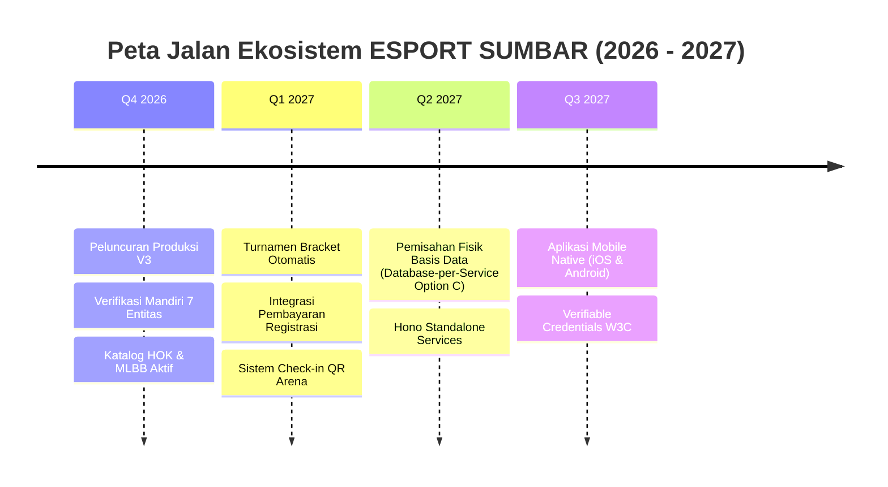

# Peta Jalan Transformasi Sistem (ROADMAP_FINAL.md)

**Proyek**: ESPORT SUMBAR V3  
**Status**: Fase Final Transformasi  
**Tanggal**: November 2026  

---

## 1. Status Realisasi Transformasi (Bagian 0 s.d. 8)

| Bagian | Deskripsi Mandat | Status Pelaksanaan | Bukti Tag Git |
|:--:|---|:--:|:--:|
| **0** | Baseline & Audit Ekstensif Arsitektur | **SELESAI (100%)** | `v2-rc1-baseline` |
| **1** | Keputusan Arsitektur (ADR) & Rencana Migrasi | **SELESAI (100%)** | `v3-part-1` |
| **2** | Fondasi Monorepo (Turborepo, Lib, Contracts) | **SELESAI (100%)** | `v3-part-2` |
| **3** | Migrasi Basis Data Domain V3 (Supabase Cloud) | **SELESAI (100%)** | `v3-part-3` |
| **4** | Lapisan Aplikasi & Panel Admin Terpadu V3 | **SELESAI (100%)** | `v3-part-4` |
| **5** | Katalog Game Dinamis & Integrasi HOK | **SELESAI (100%)** | `v3-part-5` |
| **6** | Ekosistem Terhubung Antar 7 Entitas (`relation_rules`) | **SELESAI (100%)** | `v3-part-6` |
| **7** | Strangler Fig Microservices Extraction (7.0 - 7.8) | **SELESAI (100%)** | `v3-part-7-0` s.d. `v3-part-7-8` |
| **8** | Pengelolaan Profesional & Penutupan Kontrak | **SELESAI (100%)** | `v3-part-8` |
| **9** | Uji Menyeluruh & Kesiapan Rilis Produksi | **SIAP DIEKSEKUSI** | *(Tahap Berikutnya)* |

---

## 2. Peta Jalan Jangka Panjang Pasca Peluncuran (Future Milestones)

1. **Milestone 1: Otomasi Bagan Turnamen (*Automated Bracket Engine*)**:
   - Integrasi langsung pendaftaran tim ke dalam sistem bagan turnamen *Single/Double Elimination* dan *Swiss System* dengan integrasi hasil pertandingan real-time.
2. **Milestone 2: Pemisahan Fisik Basis Data (*Database-per-Service Option C*)**:
   - Berdasarkan blueprint ADR-005 dan ADR-006, memindahkan skema logis saat ini ke instance basis data fisik terpisah per domain (*Verification DB, Content DB, Core DB*) seiring bertambahnya volume pengguna.
3. **Milestone 3: Aplikasi Mobile Native (iOS & Android)**:
   - Membangun aplikasi mobile berbasis React Native yang mengonsumsi kontrak API `@esport-sumbar/contracts` untuk scan QR-code kartu identitas di arena fisik secara luring (*offline pass*).
4. **Milestone 4: Kredensial Terverifikasi Terdesentralisasi (*Verifiable Credentials*)**:
   - Standar W3C Verifiable Credentials opsional untuk sertifikasi prestasi atlet tingkat internasional.
