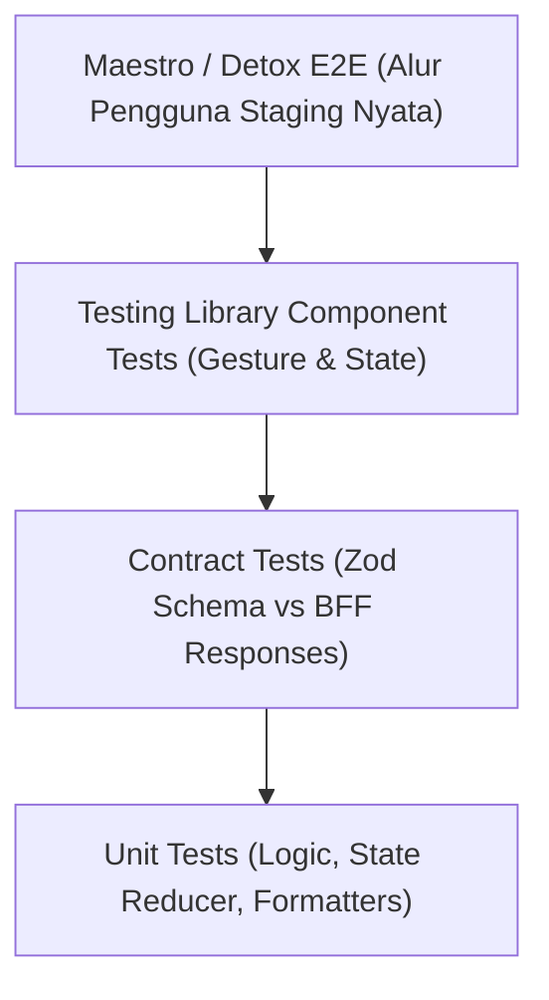

# ADR-M08: Strategi Pengujian Multi-Tier dan Matriks Perangkat Fisik

**Status**: APPROVED  
**Tanggal**: November 2026  

---

## 1. Konteks
Aplikasi mobile modern membutuhkan kepastian kinerja, kelancaran efek visual, aksesibilitas, dan ketahanan data. Klaim kualitas tidak boleh dibuat atas dasar asumsi, melainkan wajib dibuktikan dengan pengujian nyata.

## 2. Piramida Pengujian Mobile

1. **Unit & Contract Testing**:
   - `vitest` / `jest` untuk menguji mappers, reducers, dan validasi Zod kontrak API.
2. **Component Testing**:
   - `React Native Testing Library` untuk menguji interaksi tombol, transisi tab, dan render state (loading/empty/error).
3. **E2E Testing Terhadap Staging**:
   - Menggunakan **Maestro** untuk pengujian alur otomatis: Register $\rightarrow$ Onboarding $\rightarrow$ Form 7 Bidang $\rightarrow$ Upload Foto $\rightarrow$ Kartu Lahir $\rightarrow$ Ekosistem.

## 3. Matriks Perangkat Uji Nyata
| Kategori | Target Perangkat | Tolok Ukur Kritis |
| :--- | :--- | :--- |
| **Android Rendah** | RAM 3-4 GB (mis. Redmi 9 / Samsung A12) | Otomatis Mode Hemat, Cold start $\le 2.2\text{s}$, RAM $\le 180\text{ MB}$, tanpa lag scroll. |
| **Android Menengah** | RAM 6 GB (mis. Poco M4 / Samsung A34) | Mode Standar, 60 FPS stabil pada kartu 3D dan swipe tab bar. |
| **Android Flagship** | RAM 8-12 GB, 120 Hz display | Mode Penuh, 120 FPS tanpa frame drop. |
| **iPhone Layar Kecil** | iPhone SE (Gen 3) | Safe Area sempit, Dynamic Type 200%, layout tidak tertabrak. |
| **iPhone Modern** | iPhone 15 / 16 | Native glass material, Face ID biometrik, gesture haptics. |
