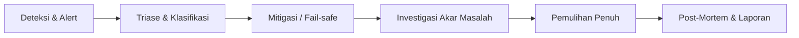

# Runbook: Respons Insiden & Mitigasi (INCIDENT_RESPONSE.md)

**Proyek**: ESPORT SUMBAR V3  
**Klasifikasi**: Internal Engineering & Operasional  
**Tujuan**: Prosedur standar deteksi, triase, mitigasi, dan pemulihan insiden sistem.

---

## 1. Tingkatan Keparahan Insiden (Severity Levels)

| Level | Kriteria & Dampak | Waktu Respons Maksimal | Eskalasi |
|---|---|---|---|
| **SEV-1 (Kritis)** | Platform tidak dapat diakses publik (*total outage*), basis data primer putus, atau kebocoran data terindikasi. | < 15 Menit | Lead Engineer, Platform Admin, Project Director |
| **SEV-2 (Tinggi)** | Fitur vital terganggu (alur pendaftaran/verifikasi gagal, kegagalan outbox, circuit breaker kritis terbuka). | < 1 Jam | Senior Engineer, On-call Engineer |
| **SEV-3 (Sedang)** | Fitur sekunder mengalami degradasi (pengiriman email tertunda, cache miss tinggi, CMS lambat). | < 4 Jam | On-call Engineer |
| **SEV-4 (Rendah)** | Masalah minor non-blokir (kesalahan tampilan visual, typo teks, perbaikan dokumentasi). | < 24 Jam | Backlog Tim |

---

## 2. Alur Respons Insiden (Workflow)



### Langkah 1: Deteksi & Verifikasi Awal
1. Periksa endpoint kesehatan probe:
   - `curl -I https://esportsumbar.id/api/healthz` (Liveness)
   - `curl -I https://esportsumbar.id/api/readyz` (Readiness)
2. Periksa telemetri di Panel Admin:
   - Buka `/admin/audit` dan `/api/admin/observability` untuk memantau status Circuit Breaker dan error rate.
3. Periksa log Vercel & Supabase Dashboard.

### Langkah 2: Mitigasi Cepat (Containment)
- **Jika Downstream Service Gagal / Lambat**:
  - Manfaatkan kill-switch Circuit Breaker untuk memutus beban downstream:
    ```bash
    curl -X POST https://esportsumbar.id/api/admin/observability \
      -H "Authorization: Bearer <ADMIN_TOKEN>" \
      -H "Content-Type: application/json" \
      -d '{"action": "trip_circuit_breaker", "name": "notification-service"}'
    ```
- **Jika Fitur Baru Menyebabkan Regresi**:
  - Nonaktifkan Feature Flag terkait di variabel lingkungan (misal: `FEATURE_FLAG_MODULAR_CORE=false` atau `FEATURE_FLAG_VERIFICATION_SERVICE=false`).
  - Deploy ulang instan tanpa memerlukan build ulang kode.

### Langkah 3: Komunikasi
- Berikan pengumuman status layanan jika insiden SEV-1 berlangsung > 30 menit.
- Saluran koordinasi teknis: Saluran internal Slack/Discord engineering ESPORT SUMBAR.

### Langkah 4: Post-Mortem
- Setiap insiden SEV-1 dan SEV-2 wajib memiliki dokumen *Blameless Post-Mortem* dalam 48 jam yang memuat:
  1. Garis waktu insiden (timeline).
  2. Akar penyebab (Root Cause Analysis - 5 Whys).
  3. Tindakan pencegahan permanen (*action items*).
