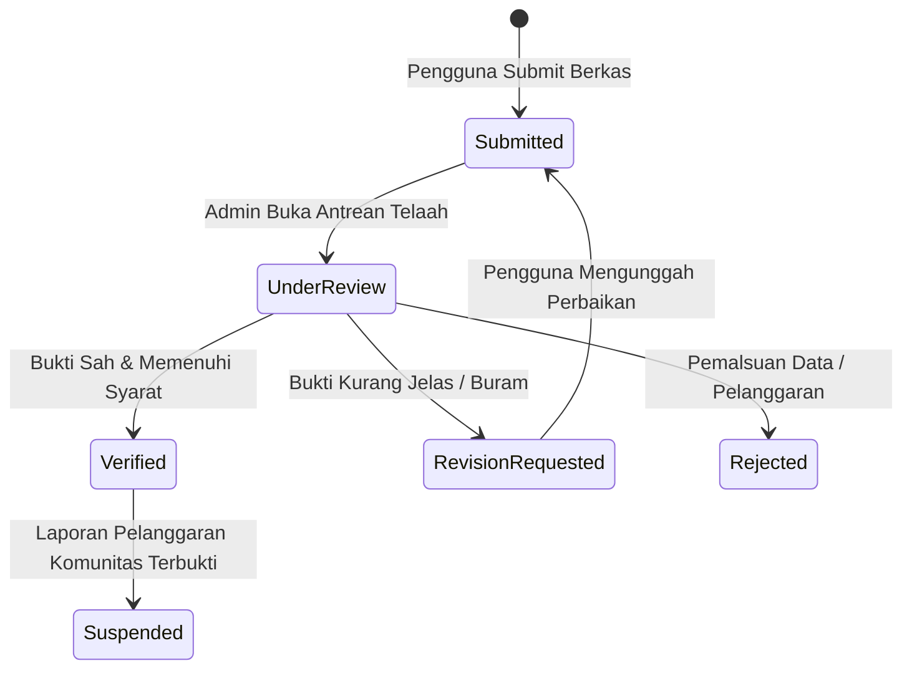

# Standar Operasional Prosedur (SOP) Verifikasi Admin ESPORT SUMBAR V3

**Nomor Dokumen**: SOP-ESB-VERIF-001  
**Tanggal Berlaku**: November 2026  
**Otoritas Penerbit**: ESPORT SUMBAR (Verifikator Tunggal)  
**Target Pengguna**: Platform Admin & Kurator Verifikasi Resmi  

---

## 1. Prinsip Dasar Verifikasi V3

1. **Satu Pintu Mandiri**: Verifikasi dilakukan langsung oleh verifikator resmi ESPORT SUMBAR tanpa perantara atau tingkatan wilayah (*single-tier direct verification*).
2. **Pemisahan Tugas (*Separation of Duties*)**:
   - Administrator platform **DILARANG KERAS** menelaah atau menyetujui pengajuan verifikasi dari profil yang terhubung ke akun pribadinya sendiri. Sistem secara otomatis memblokir aksi ini (`SelfVerificationForbiddenError`).
3. **Format Nomor Registrasi Resmi**:
   - Setiap verifikasi yang disetujui menghasilkan nomor registrasi baku:
     $$\text{ESP-SB-VER-YYYY-XXXX}$$
     *(Contoh: `ESP-SB-VER-2026-0042`)*
4. **Service Level Agreement (SLA)**:
   - **Target Penyelesaian**: Maksimal **48 Jam** sejak pengajuan disubmit pengguna.
   - **Peringatan Dini (Warning)**: Pengajuan yang belum diproses setelah **24 Jam** akan otomatis naik prioritas antrean (*Warning Tier*).
   - **Pelanggaran SLA (Breached)**: Pengajuan melebihi 48 jam otomatis masuk ke *Breached Tier* dan diprioritaskan di posisi teratas antrean admin.

---

## 2. Kriteria Bukti Kelayakan Berdasarkan 7 Entitas

| Jenis Entitas | Bukti Wajib Ditelaah | Parameter Validasi |
|---|---|---|
| **Atlet (*Player*)** | 1. Tangkapan layar profil in-game (IGN & ID terlihat jelas). 2. Bukti riwayat pertandingan/prestasi resmi. | - IGN dan ID cocok 100% dengan data formulir. - Domisili atau asal daerah di Sumatera Barat. - Tidak ada indikasi joki atau kecurangan. |
| **Pelatih (*Coach*)** | 1. Portofolio kepelatihan/sertifikat lisensi. 2. Riwayat membina tim/atlet terdaftar. | - Bukti keterlibatan aktif dalam turnamen resmi. - Verifikasi riwayat klub binaan. |
| **Tim (*Team*)** | 1. Susunan roster resmi (minimal 5 pemain aktif ber-ESPORT ID). 2. Logo resmi tim berlatar transparan (PNG/WebP). | - Seluruh pemain roster telah memiliki profil terdaftar. - Nama tim tidak melanggar hak cipta atau sara. |
| **Komunitas (*Community*)** | 1. Surat keterangan/SK pendirian komunitas. 2. Dokumentasi kegiatan gathering atau turnamen internal. | - Memiliki struktur pengurus aktif dan basis anggota di Sumbar. |
| **Arena (*Venue*)** | 1. Foto fisik arena/gaming house. 2. Spesifikasi perangkat (PC/Mobile) & bandwidth internet. | - Alamat fisik valid di salah satu dari 19 Kota/Kabupaten Sumbar. |
| **Sekolah (*School*)** | 1. Surat pengesahan ekstrakurikuler esport dari kepala sekolah. 2. Daftar siswa aktif anggota ekskul. | - Sekolah resmi berlokasi di Sumatera Barat. |
| **Perguruan Tinggi (*Campus*)** | 1. SK Organisasi Mahasiswa/UKM Esport dari Rektorat/Dekanat. 2. Surat penunjukan dosen pembina/ketua UKM. | - UKM resmi di bawah naungan universitas/institut/politeknik di Sumbar. |

---

## 3. Alur Kerja Pengambilan Keputusan (Decision Workflow)

### Opsi Keputusan:
1. **Setujui (`verified`)**:
   - Berkas lengkap, jelas, dan valid.
   - Sistem menerbitkan nomor registrasi `ESP-SB-VER-YYYY-XXXX` dan lencana verifikasi emas di kartu profil direktori.
2. **Minta Revisi (`revision_requested`)**:
   - Berkas buram, tangkapan layar terpotong, atau ID tidak terbaca.
   - Admin **wajib mencantumkan catatan revisi spesifik** (misal: *"Mohon unggah tangkapan layar profil MLBB yang menampilkan nomor ID akun"*).
   - Pengguna menerima notifikasi dan waktu 7x24 jam untuk memperbaiki berkas.
3. **Tolak (`rejected`)**:
   - Pengajuan terindikasi manipulasi data atau tidak memenuhi syarat mendasar.
   - Admin **wajib mencantumkan alasan penolakan objektif**.
4. **Tangguhkan (`suspended`)**:
   - Diberlakukan jika profil yang sebelumnya berstatus `verified` terbukti melakukan pelanggaran berat (misal: penggunaan cheat, pemalsuan identitas, atau sanksi disiplin).

---

## 4. Keamanan Audit & Integritas Penelaah

- Setiap perubahan status verifikasi **secara otomatis mencatat log audit SHA-256 append-only** yang memuat:
  - `actor_id` (ID admin yang memutuskan).
  - `target_id` (ID pengajuan verifikasi).
  - `action` (STATUS_CHANGE).
  - `hash` (Hash kriptografis berantai yang tidak dapat dimanipulasi).
- Memastikan akuntabilitas penuh jika terjadi komplain atau sengketa keputusan.
